# LAB REPORT

**Volatility Essentials, Forensic Imaging and Digital Forensics Case B4DM755**

| | |
|---|---|
| **Student Name** | Dechen Wangdra Sherpa |
| **Student ID** | 02230281 |
| **Year** | 4th Year, BE Software Engineering |
----

**Lab on the following links:**

- https://tryhackme.com/room/volatilityessentials
- https://tryhackme.com/room/forensicimaging
- https://tryhackme.com/room/caseb4dm755

---

## 1. Aim

The aim of this lab was to practise three parts of digital forensics:

- analysing memory dumps with Volatility 3
- creating and verifying a forensic disk image
- working through a full case investigation with FTK Imager and exiftool.

I wanted to understand what each tool does and why each step matters, so I explain my reasoning at each step in the evidence section.

## 2. Objectives

- Use Volatility 3 on two memory dumps to find malicious processes, their parent–child relationships, loaded DLLs, handles, injected code and hooked system calls.
- Learn the proper procedure for acquiring a forensic disk image. This means identifying the device, imaging it with `dc3dd`, verifying its integrity with hashing, and mounting the image to check its contents.
- Work through a simulated case from start to finish, from the search warrant to recovering hidden evidence with FTK Imager and exiftool, and understand the legal steps around the technical work: chain of custody and the four investigation phases.

## 3. What I Understood

**Volatility Essentials:** Volatility 3 no longer uses the profile system from version 2. It works from memory layers and symbol tables, and each plugin pulls a specific structure out of RAM. I was surprised by how much a single memory snapshot can rebuild: the process tree, loaded DLLs, open handles, injected code (`malfind`) and rootkit-style hooks (`ssdt`). It is effectively a picture of everything that was running when the capture was taken. `pslist` and `pstree` follow the linked list of processes. `psscan` scans memory for process structures, so it can also find processes that have unlinked themselves to hide.

**Forensic Imaging:** Imaging is more than copying a disk, because every step has to hold up in court. In a real case you use a write-blocker. You keep an audit trail of the commands you run. You hash the source and the copy and check that the hashes match. `dc3dd` is `dd` with progress output, logging and hashing built in, which is why forensic work prefers it. Mounting the image afterwards proves the copy is usable without touching the original.

**Case B4DM755:** This room was about the whole DFIR workflow, not a single tool. It covered the four investigation phases:

1. **Pre-search:** get the warrant and request that data be preserved.
2. **Search:** seize and acquire the evidence.
3. **Post-search:** forensic analysis of the evidence.
4. **Trial:** present the evidence with documentation, and show that the hashes match.

On the technical side, the evidence wasn't hidden in any clever way:

- JPEG photos had been renamed to `.pdf`.
- A zip archive had been renamed to `.xlsx`.
- Phone metadata had been left in the photos.
- Deleted files could still be recovered from the image.

Most real forensic work comes down to being thorough and checking every file.

## 4. Summary

Across the three rooms I:

- Identified the suspicious Adobe process `Reader_sl.exe` (PID 1640) in Case 001 and traced its parent `explorer.exe` (PID 1484), its DLLs, its handles, injected code and the hooked `NtCreateFile` SSDT entry. In Case 002, I confirmed a **WannaCry** infection by tracing `@WanaDecryptor@` (PID 740) back to its parent `tasksche.exe`.
- Created raw forensic images of two loop devices with `dc3dd`. For both, the MD5 hash of the image matched the hash of the source device. I then mounted the images and recovered the flags.
- Completed the B4DM755 case:
  - confirmed the flash drive had no EFS encryption
  - imaged it in FTK Imager, with matching MD5 and SHA1 hashes
  - counted the current, deleted and corrupted files
  - used exiftool to show the "PDFs" were really JPEG photos and to identify the phones that took them
  - found that `operations.xlsx` was a zip archive and extracted it, which gave me contacts, GPS coordinates and the password for `pandorasbox.zip`
  - traced the stolen source code to SwiftSpend Financial, found the beneficiary in an unsigned document, and recovered the hidden flag.

All three rooms were completed (screenshots 11, 19 and 34).

---

## 5. Screenshots of the Lab

### 5.1 Volatility Essentials

#### Case 001: Adobe process (Investigation-1.vmem)

First I pulled basic information about the host from the memory dump to find the Windows build and the time of capture.

```bash
python3 vol.py -f ~/Desktop/Investigations/Investigation-1.vmem windows.info
```

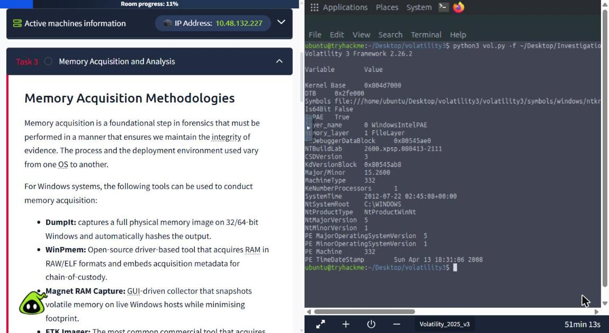

*Screenshot 1: `NTBuildLab` shows build **2600.xpsp.080413-2111** and `SystemTime` shows the memory was captured at **2012-07-22 02:45:08**.*

Next, I searched the process tree for anything Adobe-related.

```bash
python3 vol.py -f ~/Desktop/Investigations/Investigation-1.vmem windows.pstree | grep -i adobe
```

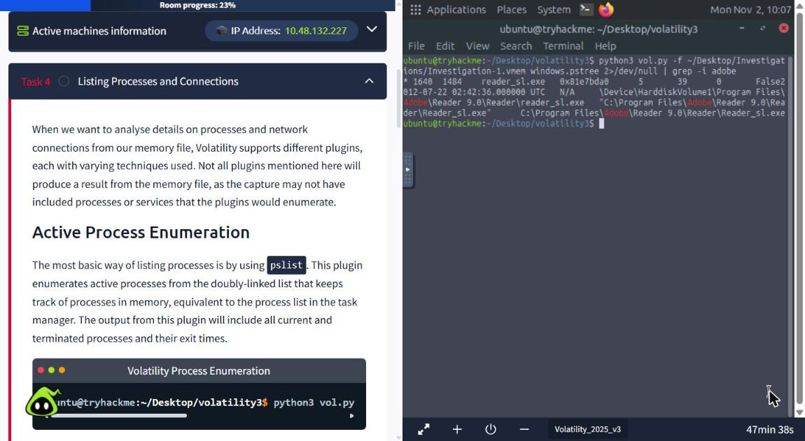

*Screenshot 2: `reader_sl.exe` (PID 1640, PPID 1484) running from **C:\Program Files\Adobe\Reader 9.0\Reader\Reader_sl.exe**.*

To confirm the parent process, I used `psscan` and filtered for both PIDs.

```bash
python3 vol.py -f ~/Desktop/Investigations/Investigation-1.vmem windows.psscan | grep -E 'PID|1484|1640'
```

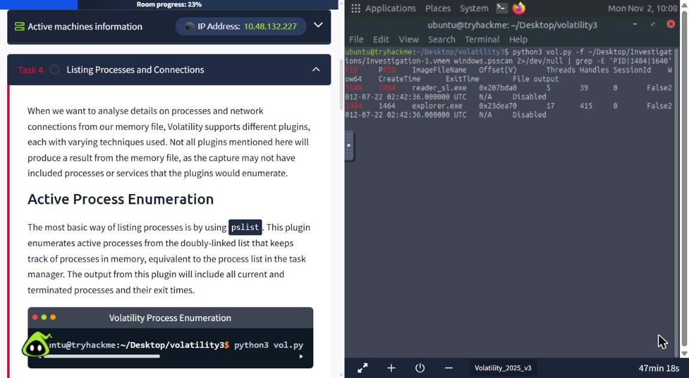

*Screenshot 3: **PID 1640 (reader_sl.exe)** has PPID 1484, and **PID 1484 is explorer.exe**, so explorer.exe is the parent.*

I then listed the DLLs loaded by the Adobe process that are **outside** `system32`, since DLLs from unusual locations can be a sign of something wrong.

```bash
python3 vol.py -f ~/Desktop/Investigations/Investigation-1.vmem windows.dlllist --pid 1640 | grep -v -i system32
```

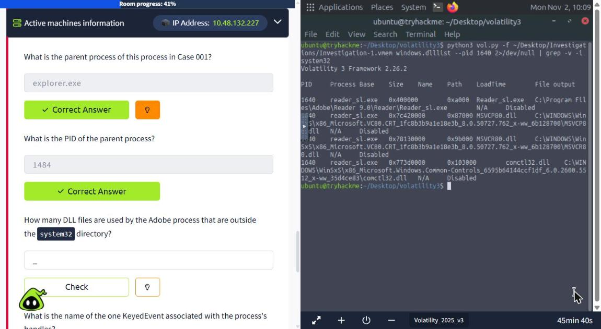

*Screenshot 4: Apart from the executable itself, **3 DLLs** are loaded from outside system32: `MSVCP80.dll`, `MSVCR80.dll` and `comctl32.dll`, all from `WinSxS`.*

Then I checked the process's handles for the KeyedEvent.

```bash
python3 vol.py -f ~/Desktop/Investigations/Investigation-1.vmem windows.handles --pid 1640 | grep -i keyedevent
```

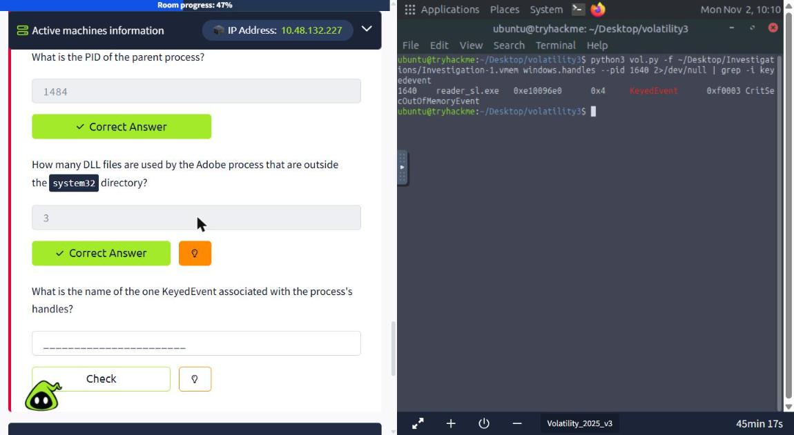

*Screenshot 5: The single KeyedEvent handle is **CritSecOutOfMemoryEvent**.*

To look for injected code, I ran `malfind` and filtered for memory regions that start with an `MZ` header, meaning a Windows executable loaded somewhere it shouldn't be.

```bash
python3 vol.py -f ~/Desktop/Investigations/Investigation-1.vmem windows.malfind | grep -i "mz header"
```

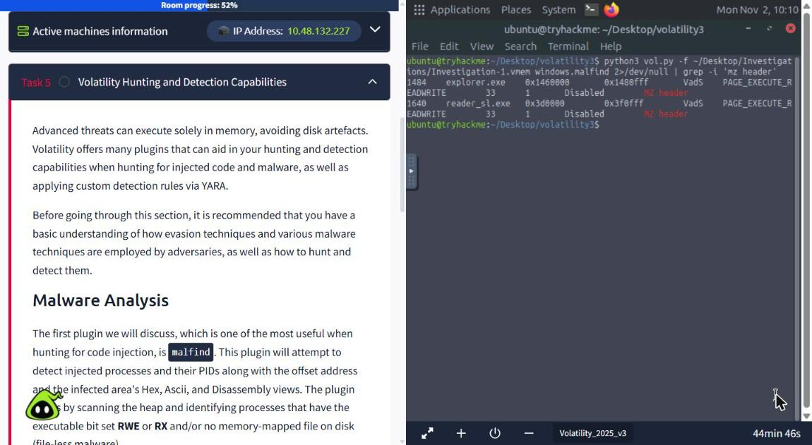

*Screenshot 6: Both **explorer.exe** and **reader_sl.exe** have `PAGE_EXECUTE_READWRITE` regions starting with an MZ header, which points to code injection.*

Finally, I checked the SSDT for kernel-level hooking, which is a common rootkit technique.

```bash
python3 vol.py -f ~/Desktop/Investigations/Investigation-1.vmem windows.ssdt | grep -i -E 'Index|NtCreateFile'
```

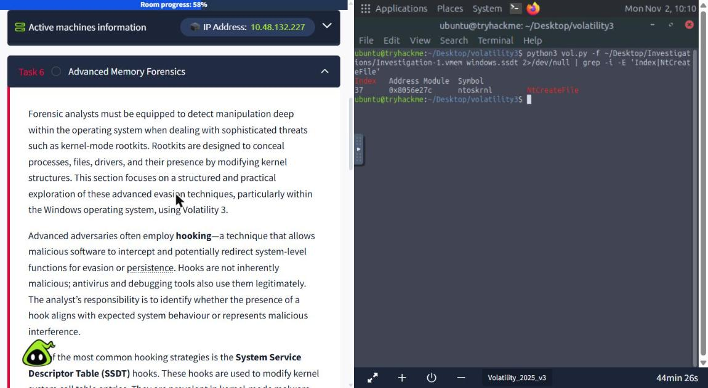

*Screenshot 7: `NtCreateFile` is at index 37, address **0x8056e27c**, in `ntoskrnl`.*

#### Case 002: Ransomware (Investigation-2.raw)

In the second dump, the room said a suspicious process was running at PID 740.

```bash
python3 vol.py -f ~/Desktop/Investigations/Investigation-2.raw windows.psscan --pid 740
```

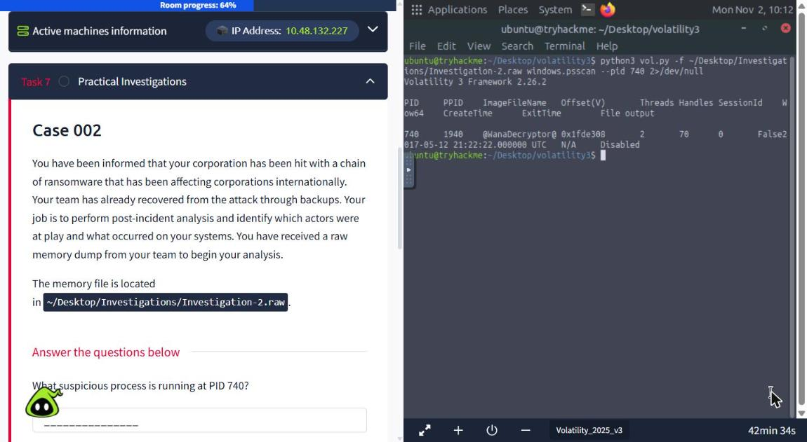

*Screenshot 8: PID 740 is **@WanaDecryptor@**, created on 2017-05-12, the day the WannaCry outbreak started.*

Then I got the binary's full path from its DLL list.

```bash
python3 vol.py -f ~/Desktop/Investigations/Investigation-2.raw windows.dlllist --pid 740 | head -8
```

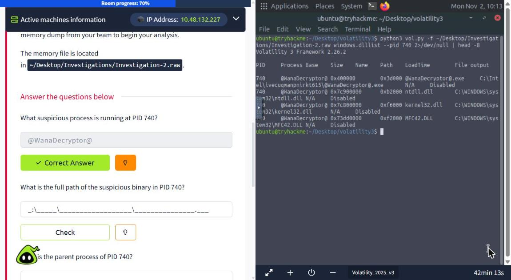

*Screenshot 9: The binary runs from **C:\Intel\ivecuqmanpnirkt615\@WanaDecryptor@.exe**.*

Then I traced its parent process.

```bash
python3 vol.py -f ~/Desktop/Investigations/Investigation-2.raw windows.pstree --pid 740
```

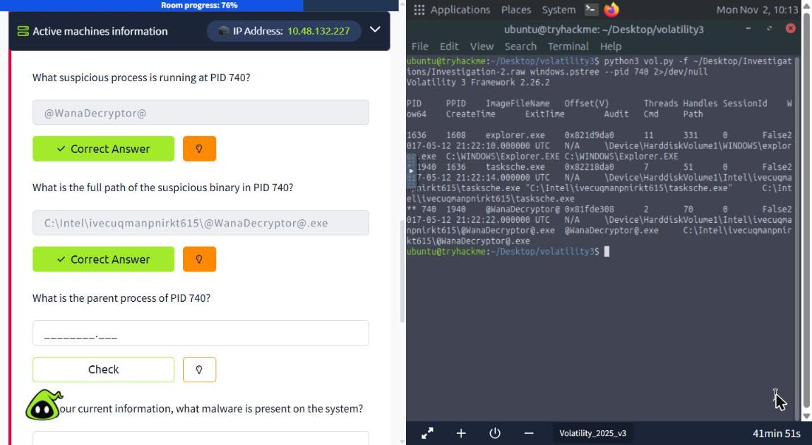

*Screenshot 10: The chain is explorer.exe (1636) → **tasksche.exe** (1940) → @WanaDecryptor@ (740). `tasksche.exe` running from the same `C:\Intel\...` folder is WannaCry's dropper. The malware is **WannaCry**. The `windows.filescan` plugin can list every file loaded from that working folder.*


*Screenshot 11: Volatility Essentials room completed (8/8 tasks).*

---

### 5.2 Forensic Imaging

On the Task 2 machine I started by listing all block devices to find the target drive. It isn't mounted, so `df` doesn't show it.

```bash
lsblk -a
```

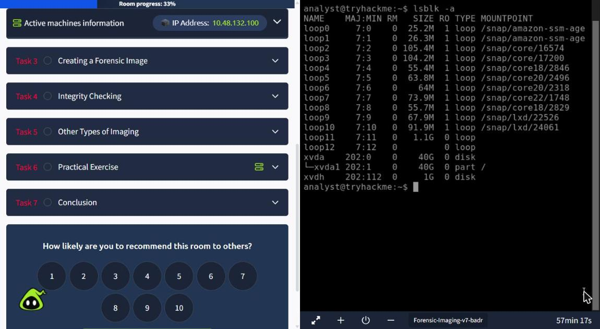

*Screenshot 12: **loop11** is 1.1G and not mounted, which matches the virtual disk described in the task.*

After identifying the device, I imaged it with `dc3dd` and saved a log file as part of the audit trail.

```bash
sudo dc3dd if=/dev/loop11 of=example1.img log=imaging_loop11.txt
```

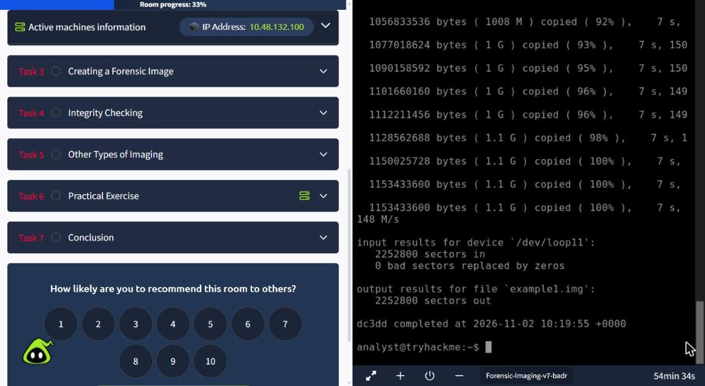

*Screenshot 13: dc3dd copied 1,153,433,600 bytes: 2,252,800 sectors in and 2,252,800 sectors out, with 0 bad sectors.*

To prove the image is an exact copy, I hashed both the image and the source device.

```bash
sudo md5sum example1.img
sudo md5sum /dev/loop11
```

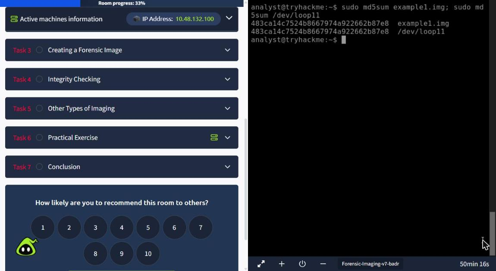

*Screenshot 14: Both hashes are **483ca14c7524b8667974a922662b87e8**, so the image is an exact copy of the source.*

For the integrity-checking question, I hashed the provided `exercise.img`.

```bash
sudo md5sum /home/analyst/exercise.img
```

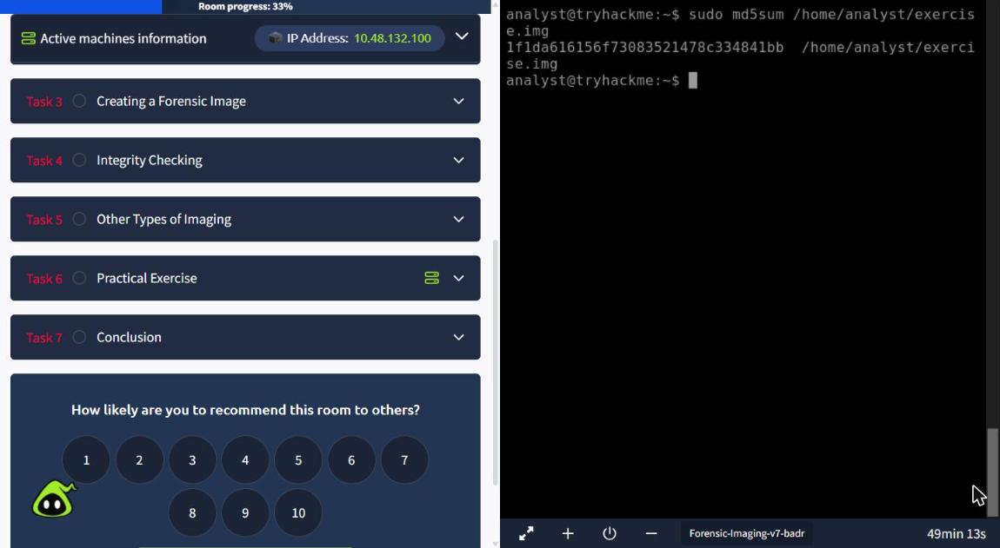

*Screenshot 15: The MD5 of exercise.img is **1f1da616156f73083521478c334841bb**.*

Then I mounted the image through a loop device to check that it works and to read its contents.

```bash
sudo mkdir -p /mnt/exercise
sudo mount -o loop /home/analyst/exercise.img /mnt/exercise
cat /mnt/exercise/flag.txt
```

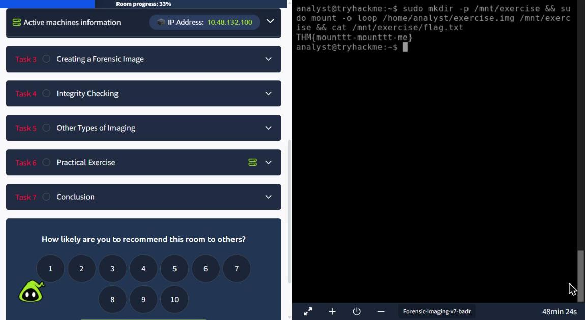

*Screenshot 16: The flag is **THM{mounttt-mounttt-me}**.*

#### Practical Exercise (Task 6 machine)

On the practical machine, the 1 GB device was **loop4**. I repeated the process: image the device, then compare the hashes.

```bash
sudo dc3dd if=/dev/loop4 of=practical.img log=imaging_loop4.txt
sudo md5sum practical.img
sudo md5sum /dev/loop4
```

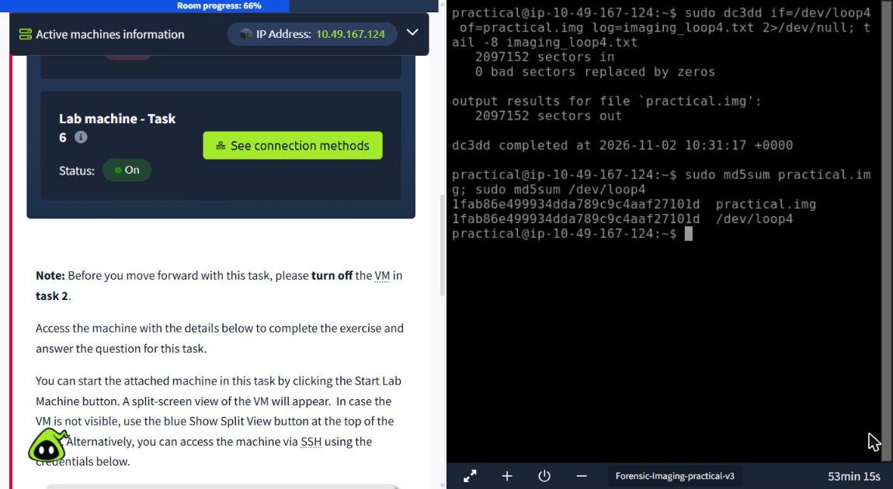

*Screenshot 17: dc3dd copied 2,097,152 sectors with 0 bad sectors. The image and `/dev/loop4` both hash to **1fab86e499934dda789c9c4aaf27101d**.*

Then I mounted the device and read the flag.

```bash
sudo mkdir -p /mnt/loop4
sudo mount /dev/loop4 /mnt/loop4
cat /mnt/loop4/flag.txt
```

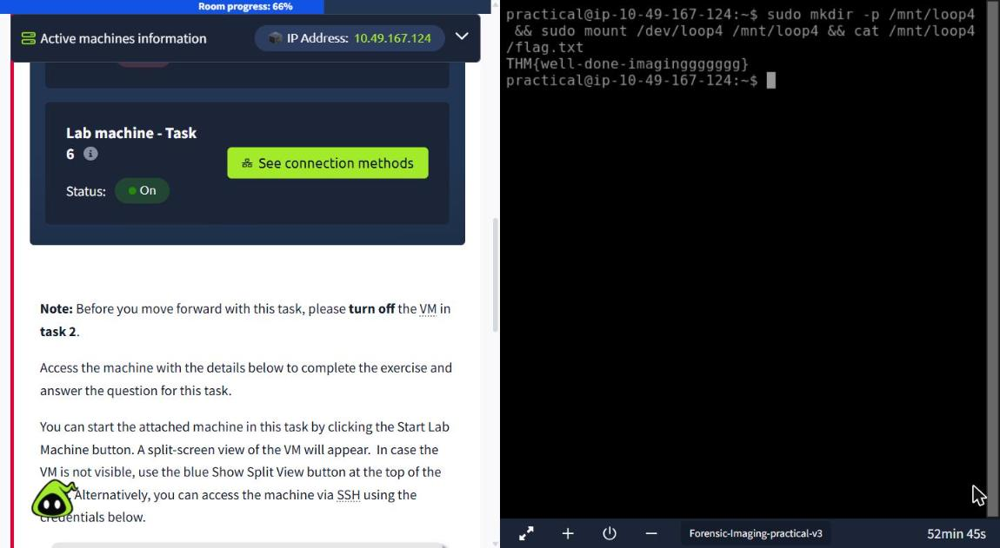

*Screenshot 18: The flag is **THM{well-done-imaginggggggg}**.*


*Screenshot 19: Forensic Imaging room completed (7/7 tasks).*

---

### 5.3 Digital Forensics Case B4DM755

Tasks 1–4 were about the scenario and had no lab machine. They covered:

- my role: **Forensics Lab Analyst**, assigned as the **DFIR First Responder**
- what I had to gather: **digital artefacts and evidence**
- the legal requirement: a **search warrant**
- the field procedure: check for **drive encryption**, **hash and copy** files, then **bag, seal and tag** the artefacts
- what was found: the only artefact recovered from the suspect's home was a **flash drive**, which had to be imaged
- the chain of custody: **proper documentation** keeps everyone accountable.

I answered these in the room. The screenshots below cover the hands-on part.

#### Checking for encryption (FTK Imager)

In FTK Imager I went to File → Add Evidence Item → Physical Drive and chose **\\.\PHYSICALDRIVE2 – Microsoft Virtual Disk [1GB]**. Then I ran File → Detect EFS Encryption.

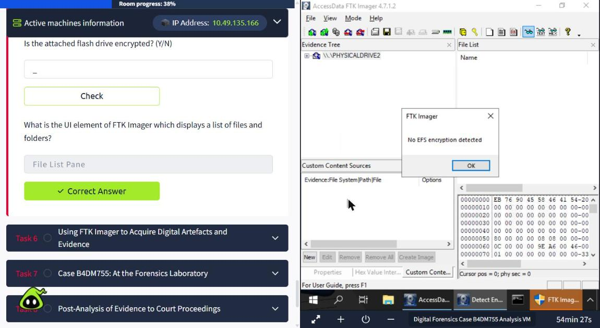

*Screenshot 20: "No EFS encryption detected", so the flash drive is not encrypted.*

#### Creating the forensic image

I used File → Create Disk Image → Physical Drive → PHYSICALDRIVE2 → Raw (dd). I ticked "Verify images after they are created" and "Create directory listings", entered case number B4DM755, evidence number 001 and myself as examiner, and saved the image to the Desktop.

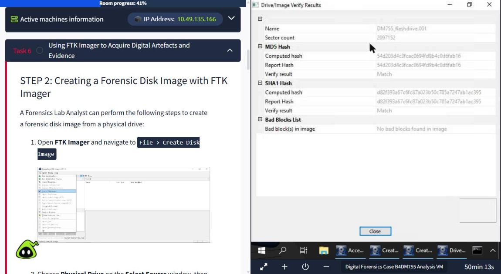

*Screenshot 21: The Drive/Image Verify Results show that both hashes match the drive:*

- *MD5: **54d203d4c3fcac0694fd9b4c0d6fab16***
- *SHA1: **d82f393a67c6fc87a023b50c785a7247ab1ac395***

*No bad blocks were found.*

#### Counting the files on the drive

In File Explorer I opened the flash drive (**PERSONAL (D:)**) and turned on *Hidden items* in the View tab.

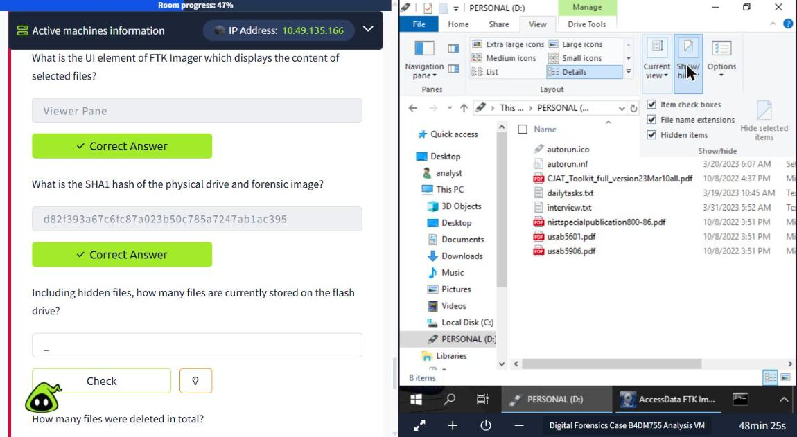

*Screenshot 22: With hidden items shown there are **8 files** on the drive, including the hidden `autorun.ico` and `autorun.inf`.*

#### Deleted and corrupted files

In FTK Imager I expanded PERSONAL [exFAT] → [root]. FTK shows deleted files with a **red X** on the icon.

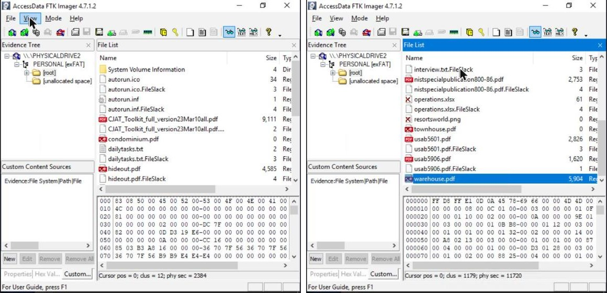

*Screenshot 23: The file list, split into two halves (top and bottom), shows **6 deleted files**: `condominium.pdf`, `hideout.pdf`, `operations.xlsx`, `resortsworld.png`, `townhouse.pdf` and `warehouse.pdf`.*

I then sorted the file list by size to find recovered files of 0 bytes, which means their content is gone.

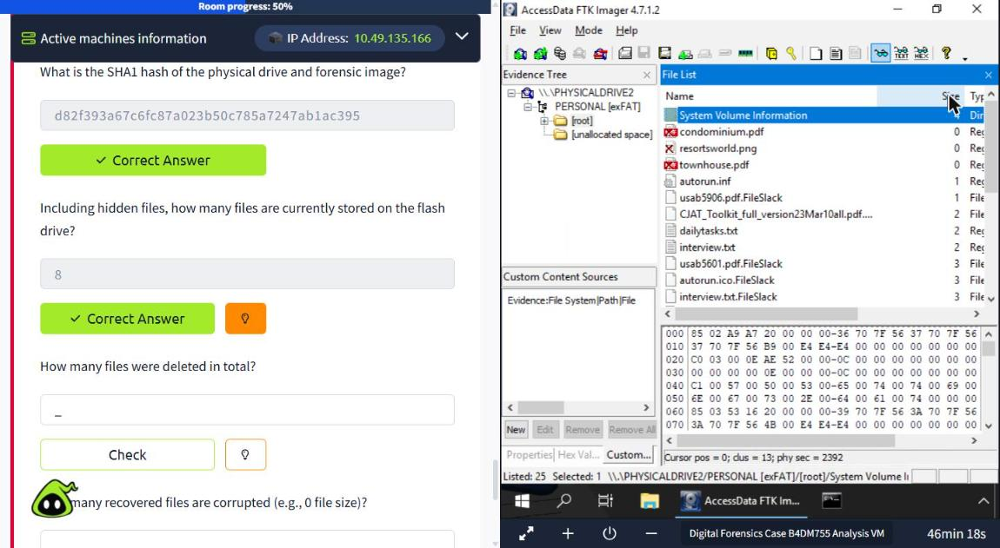

*Screenshot 24: **3 recovered files** are 0 bytes: `condominium.pdf`, `resortsworld.png` and `townhouse.pdf`.*

#### At the Forensics Laboratory

First I checked the tools folder on the Desktop.

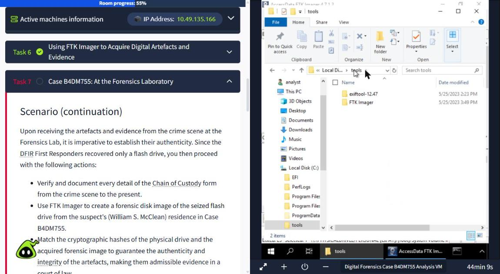

*Screenshot 25: Besides FTK Imager, the other tool is **exiftool-12.47**.*

I exported the whole `[root]` folder from the image with right-click → Export Files, which recovers the deleted files as well. Then I ran exiftool on `hideout.pdf`.

```cmd
C:\tools\exiftool-12.47\exiftool.exe hideout.pdf
```

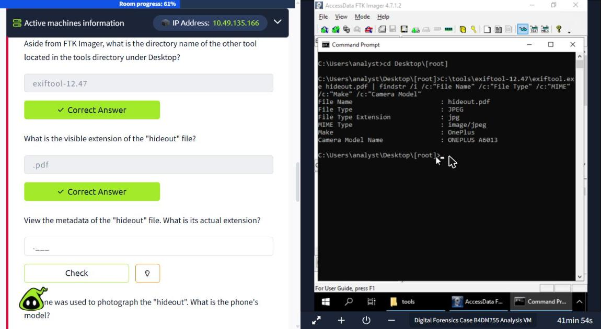

*Screenshot 26: The visible extension is `.pdf`, but the metadata shows File Type **JPEG**, so the real extension is **.jpg**. It is a photo taken with a OnePlus **ONEPLUS A6013**.*

I did the same for `warehouse.pdf`.

```cmd
C:\tools\exiftool-12.47\exiftool.exe warehouse.pdf
```

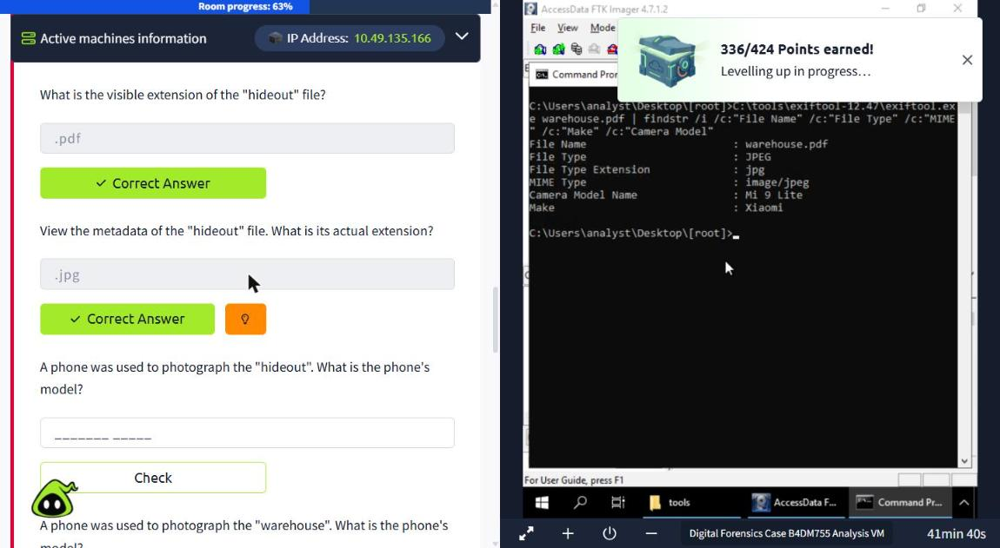

*Screenshot 27: Also a JPEG, taken with a Xiaomi **Mi 9 Lite**.*

#### operations.xlsx: a zip in disguise

Opening `operations.xlsx` as a zip showed that it held `operations/notes.txt` and `operations/pandorasbox.zip`, not spreadsheet data. I copied it to `ops.zip`, extracted it and read the notes.

```cmd
copy operations.xlsx C:\Users\analyst\Desktop\ops.zip
powershell -c "Expand-Archive C:\Users\analyst\Desktop\ops.zip C:\Users\analyst\Desktop\ops"
more C:\Users\analyst\Desktop\ops\operations\notes.txt
```

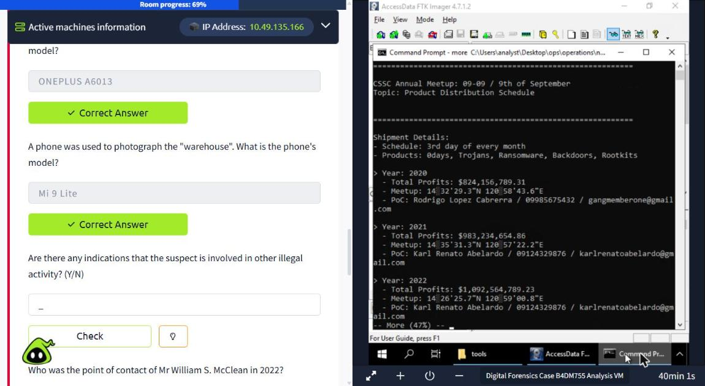

*Screenshot 28: The notes describe a "Product Distribution Schedule" for 0days, trojans, ransomware, backdoors and rootkits, with profits listed by year. This is clear evidence of **other illegal activity (Y)**. The **2022** entry gives the point of contact as **Karl Renato Abelardo** and the meetup coordinates as **14°26'25.7"N 120°59'00.8"E**.*

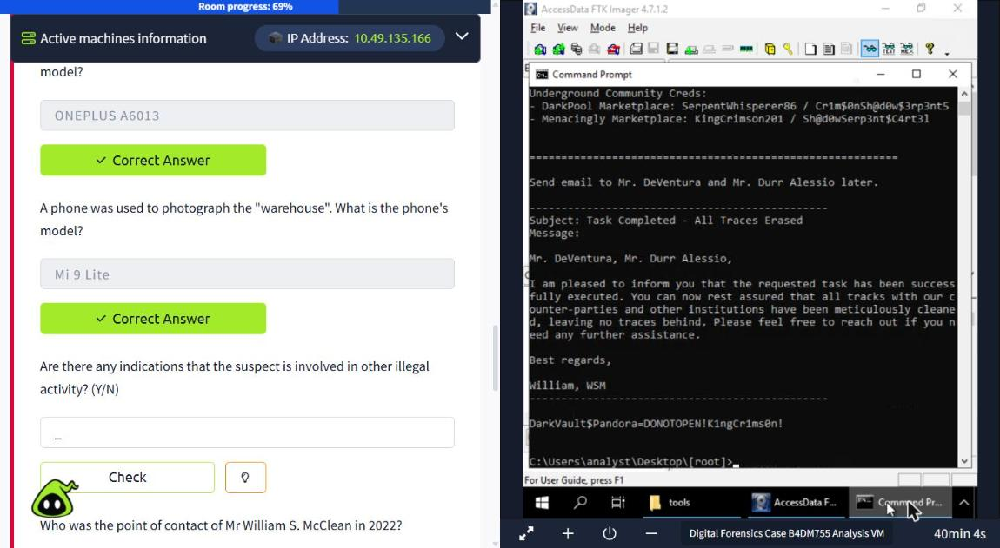

*Screenshot 29: The end of the notes shows dark-marketplace credentials, a "task completed, all traces erased" email to Mr. DeVentura and Mr. Durr Alessio, and the zip password **DarkVault$Pandora=DONOTOPEN!K1ngCr1ms0n!**.*

#### pandorasbox.zip

Windows' built-in `Expand-Archive` can't open password-protected zips, so I used the built-in `tar` with the password.

```cmd
tar -xvf pandorasbox.zip -C pbox --passphrase "DarkVault$Pandora=DONOTOPEN!K1ngCr1ms0n!"
dir /s /b pbox
```

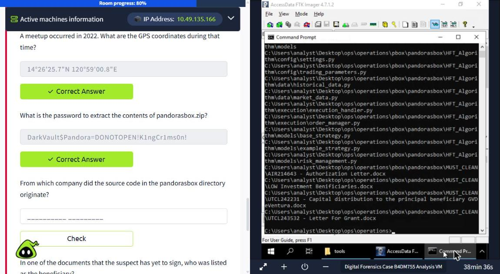

*Screenshot 30: The archive holds the `HFT_Algorithm` source code and a `MUST_CLEAN` folder of Word documents.*

To find out where the source code came from, I searched the file headers.

```cmd
findstr /s /i /n "copyright company proprietary corp inc ltd llc" *.py *.txt *.md
```


*Screenshot 31: Every file header says `Company: SwiftSpend Financial` and is labelled "CONFIDENTIAL AND PROPRIETARY". The code was stolen from **SwiftSpend Financial**.*

I extracted the text from the Word documents in `MUST_CLEAN` and searched it for "beneficiary" and "sign".

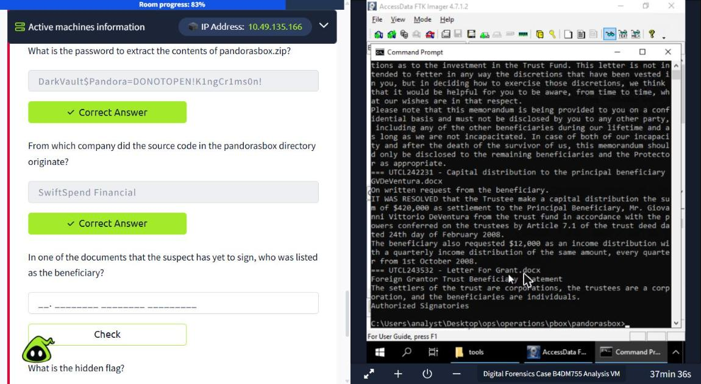

*Screenshot 32: `UTCL242231 – Capital distribution to the principal beneficiary GVDeVentura.docx` approves a $420,000 capital distribution to the principal beneficiary, **Mr. Giovanni Vittorio DeVentura**.*

Finally, I searched all the extracted evidence for a flag. It was in a file named `DONOTOPEN` inside pandorasbox.

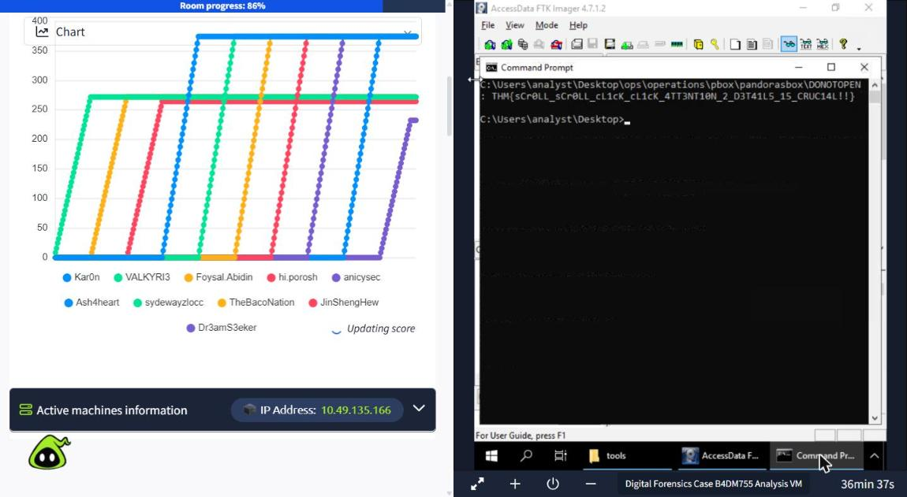

*Screenshot 33: The hidden flag is **THM{sCr0LL_sCr0LL_cL1cK_cL1cK_4TT3NT10N_2_D3T41L5_15_CRUC14L!!}**.*

#### Post-analysis to court proceedings

In Task 8:

- the warrant is obtained in the **Pre-search** phase
- the forensic analysis happens in the **Post-search** phase
- the evidence is presented in court with documentation in the **Trial** phase.


*Screenshot 34: Digital Forensics Case B4DM755 room completed (8/8 tasks).*

---

## Conclusion

This lab connected three parts of the DFIR process: memory analysis, disk imaging and a full case investigation. The case room was the most useful for me because it tied the technical work back to the legal side: the warrant, chain of custody, matching hashes and presenting evidence at trial. Across the three rooms I got hands-on practice with Volatility 3, `dc3dd`, MD5/SHA1 integrity checks, mounting images, FTK Imager and exiftool. I also learned that the evidence is often hiding in plain sight, behind a wrong file extension or inside a deleted file.
